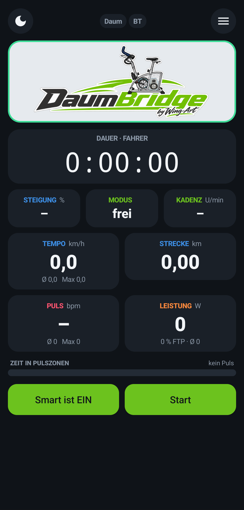
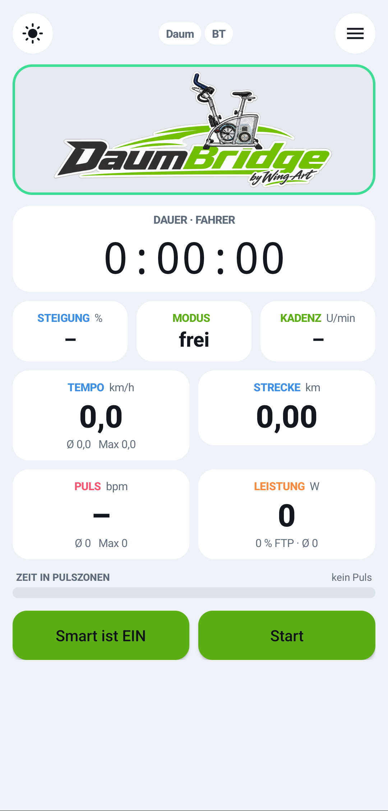
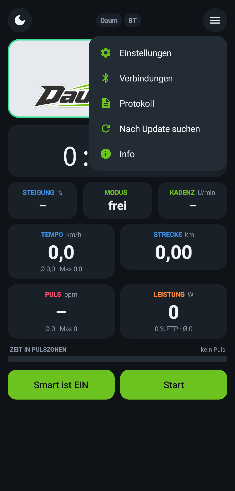
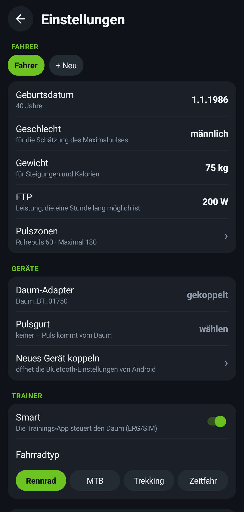
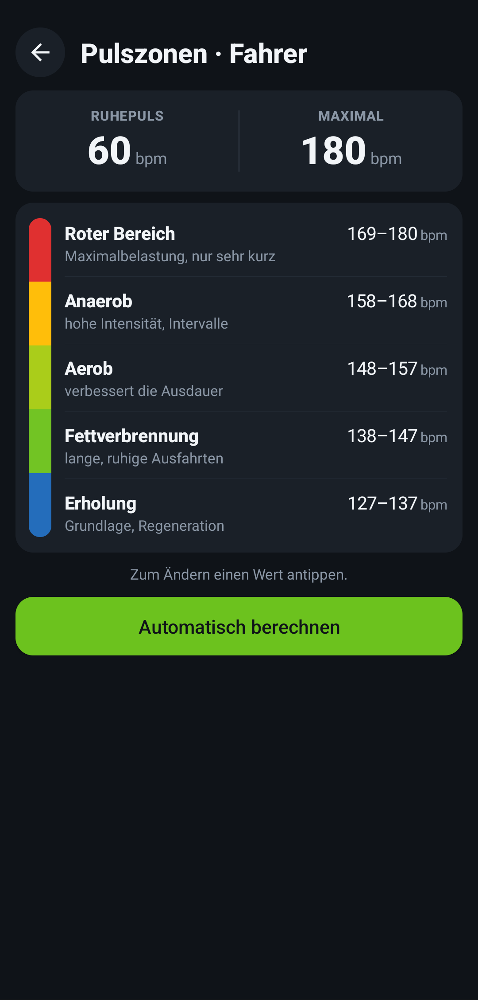
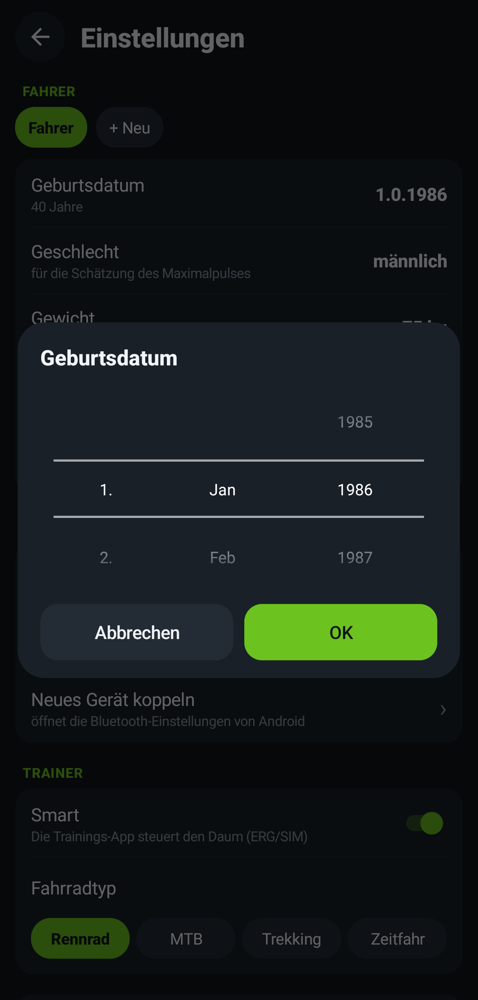

<p align="right"><a href="README.md"><b>🇩🇪 Deutsche Version</b></a></p>

<p align="center"></p>

<p align="center"><b>Turn your Daum ergometer into a smart trainer for Zwift, MyWhoosh, Rouvy &amp; co.</b></p>

<p align="center">📱 <b>Just a phone + Bluetooth adapter</b> · 🔌 <b>no cables</b> · 🧰 <b>no Raspberry Pi, no tinkering</b></p>

<p align="center">
<b>Current version: 0.9.4 (Build 30)</b> – pre-release (beta)<br>
Android 7 or newer · free · no ads · no account
</p>

<p align="center"><a href="https://raw.githubusercontent.com/MAXimator70/daumbridge/main/DaumBridge.apk"><b>⬇ Download DaumBridge</b></a></p>

> **Note:** The app itself is currently in **German**. This documentation explains every step in English and gives the German menu names in *italics* (with translation).

---

## What is DaumBridge?

Older Daum ergometers such as the **Daum 8008 TRS 3** only speak their own serial protocol – Zwift and MyWhoosh don't know them.
DaumBridge runs on an Android phone, connects to the ergometer through the **blue Daum Bluetooth adapter** and shows up in your training app as a regular **Bluetooth smart trainer (FTMS)**.

```
Daum 8008  ──(Daum Bluetooth adapter)──▶  Android phone with DaumBridge  ──(Bluetooth FTMS)──▶  Zwift / MyWhoosh / Apple TV / PC
```

## Why DaumBridge?

Other solutions for older Daum ergometers need a **USB serial cable** on the phone or a **Raspberry Pi** and some tinkering. DaumBridge doesn't:

| | DaumBridge | typical alternatives |
|---|---|---|
| Connection to the Daum | **wireless via Bluetooth adapter** | USB-RS232 cable, often with OTG adapter |
| Extra hardware | **none** – just the Bluetooth adapter on the Daum | cable, sometimes a Raspberry Pi |
| Setup | install app, pair adapter, start | cable, drivers, sometimes Linux skills |
| Phone placement | **anywhere**, e.g. on the handlebar or a table | tied to the cable |
| Cost | **free** | varies |

The original Daum adapter is sold out? A standard [Bluetooth RS232 adapter](docs/en/ADAPTER.md) works too – still without a cable to the phone.

<p align="center">



</p>

## Features

- **Smart trainer via Bluetooth FTMS** – ERG mode (target watts), slope simulation (SIM) and resistance
- **Sends** power, cadence, speed and heart rate to your training app
- **Bluetooth heart rate strap** (e.g. Polar H9/H10, Garmin, Wahoo) – DaumBridge reads the strap and passes the heart rate on
- **Rider profiles** – date of birth, weight, FTP, heart rate strap and heart rate zones per person
- **Heart rate zones** – calculated from your max heart rate or set manually
- **Zone colours** – heart rate and power tiles change colour by zone, a bar shows your time in each heart rate zone
- **Live chart** – tap the logo, it flips over and shows power, cadence and heart rate; swipe to scroll back, double-tap = live
- **Summary** after each ride (duration, distance, power, Normalized Power, kJ, heart rate, zones)
- **Share rides as FIT files** – to Telegram, Google Drive, Dropbox, Synology, MaxUp, Strava …; all rides stay saved on the phone (menu ☰ → Trainings)
- **Reconnects automatically** if the Daum adapter or the heart rate strap drops out
- **Simulator strength** – make climbs feel easier if you like
- **Light and dark mode**, scroll wheels instead of keyboard input
- **Updates** – the app tells you when a new version is available

<p align="center">



</p>

## Requirements

| | |
|---|---|
| Ergometer | Daum 8008 TRS 3 (other Daum ergometers with the same protocol may work but are untested) |
| Adapter | blue Daum Bluetooth adapter – or a standard Bluetooth RS232 adapter (classic Bluetooth/SPP, DB9), see [Adapters](docs/en/ADAPTER.md) |
| Phone | Android 7 or newer with Bluetooth Low Energy |
| Training app | any app that supports Bluetooth FTMS trainers: Zwift, MyWhoosh, Rouvy, TrainerRoad, Kinomap … – on PC, Mac, tablet or Apple TV |

> **iPhone:** unfortunately not possible. The Daum adapter uses classic Bluetooth, which iPhones may only access for Apple-certified (MFi) devices. More in the [FAQ](docs/en/FAQ.md).

## Up and running in 5 minutes

1. **Install:** On your phone, [download DaumBridge.apk](https://raw.githubusercontent.com/MAXimator70/daumbridge/main/DaumBridge.apk), open it and install. Android asks once whether your browser may install apps – allow it.
2. **Pair the adapter:** Switch on the Daum, open *Settings → Bluetooth* on the phone and pair the Daum adapter. If Android asks for a PIN, it's the 4-digit number printed on the adapter – some adapters pair without a PIN.
3. **Select it in DaumBridge:** menu ☰ → *Einstellungen* (Settings) → *Geräte* (Devices) → *Daum-Adapter*.
4. Tap **Start**.
5. **In your training app**, search for a trainer and choose **"DaumBridge"** – for power, cadence and control.

Full guide with heart rate strap, rider profiles and zones: **[Guide](docs/en/GUIDE.md)**

## Documentation

- 📖 [Guide](docs/en/GUIDE.md) – step-by-step setup
- 🔌 [Bluetooth adapters](docs/en/ADAPTER.md) – replacements for the sold-out Daum adapter
- ❓ [FAQ and troubleshooting](docs/en/FAQ.md)
- 🔒 [Privacy](docs/en/PRIVACY.md)
- 📝 [Version history](Versionen.md) (German)

## Notes

- DaumBridge is a **private hobby project** and a **pre-release**. Use at your own risk, without warranty.
- Heart rate zones and calories are **estimates** and **not medical advice**. If in doubt, consult a doctor before training.
- DaumBridge is **not an official product** and is not affiliated with Daum Electronic, Zwift, MyWhoosh or any other company mentioned. All trademarks belong to their owners.
- The source code is not public.

---
DaumBridge by Wing-Art
