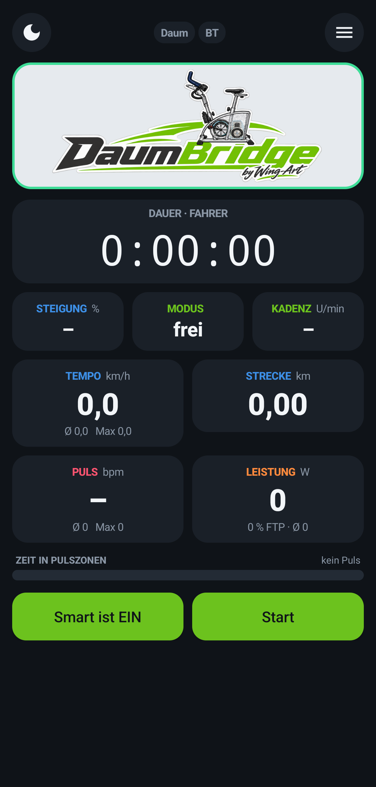
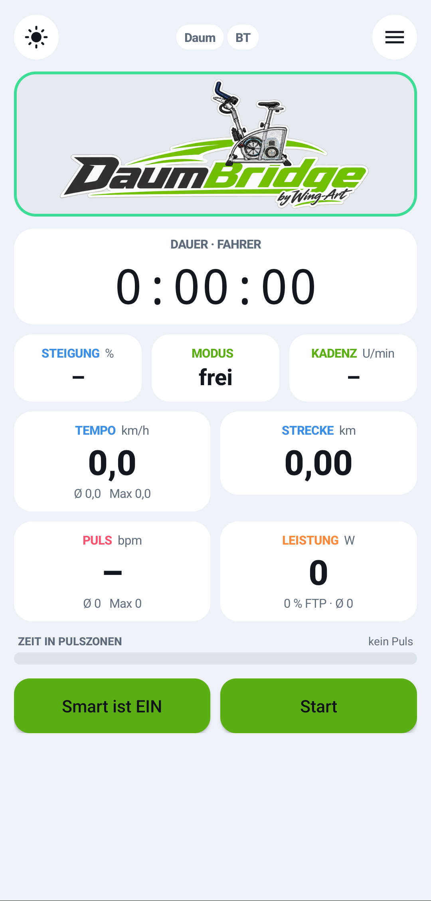
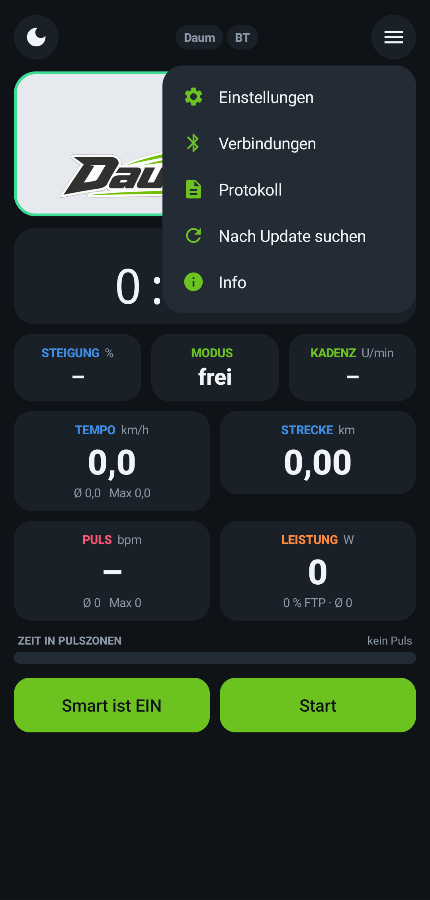
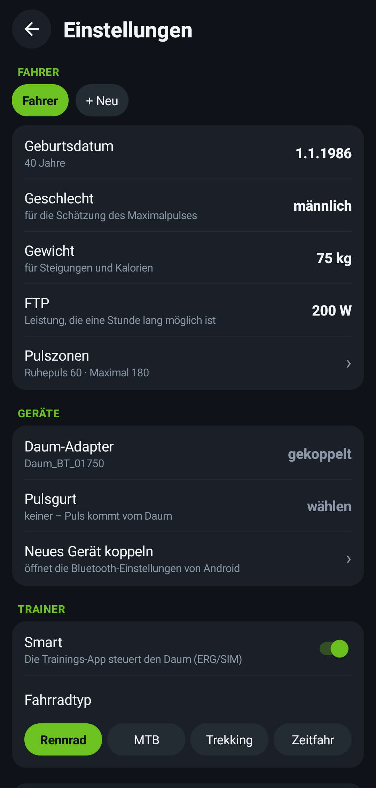
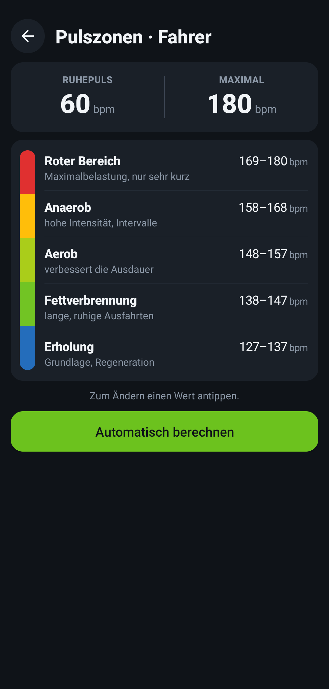
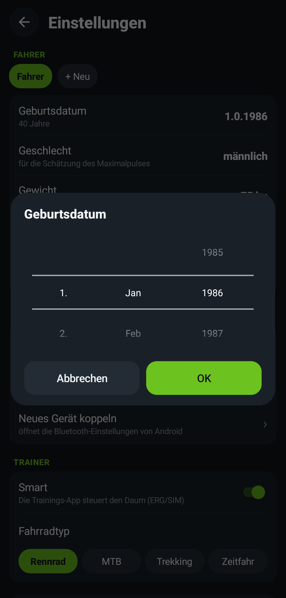

<p align="center"></p>

<p align="center"><b>Dein Daum-Ergometer als Smart-Trainer für Zwift, MyWhoosh, Rouvy &amp; Co.</b></p>

<p align="center">📱 <b>Nur Handy + Bluetooth-Adapter</b> · 🔌 <b>kein Kabel</b> · 🧰 <b>kein Raspberry Pi, kein Basteln</b></p>

<p align="center">
<b>Aktuelle Version: 0.8.1 (Build 25)</b> – Vorabversion (Beta)<br>
Android 7 oder neuer · kostenlos · ohne Werbung · ohne Konto
</p>

<p align="center"><a href="https://raw.githubusercontent.com/MAXimator70/daumbridge-download/main/DaumBridge.apk"><b>⬇ DaumBridge herunterladen</b></a></p>

---

## Was ist DaumBridge?

Ältere Daum-Ergometer wie der **Daum 8008 TRS 3** sprechen nur ihr eigenes serielles Protokoll – Zwift und MyWhoosh kennen sie nicht.
DaumBridge läuft auf einem Android-Handy, verbindet sich über den **blauen Daum-Bluetooth-Adapter** mit dem Ergometer und meldet sich bei der Trainings-App als ganz normaler **Bluetooth-Smart-Trainer (FTMS)**.

```
Daum 8008  ──(Daum-Bluetooth-Adapter)──▶  Android-Handy mit DaumBridge  ──(Bluetooth FTMS)──▶  Zwift / MyWhoosh / Apple TV / PC
```

## Warum DaumBridge?

Andere Lösungen für ältere Daum-Ergometer brauchen ein **USB-Seriell-Kabel** am Handy oder einen **Raspberry Pi** mit Bastelarbeit. DaumBridge nicht:

| | DaumBridge | übliche Alternativen |
|---|---|---|
| Verbindung zum Daum | **kabellos per Bluetooth-Adapter** | USB-RS232-Kabel, oft mit OTG-Adapter |
| Zusätzliche Hardware | **keine** – nur der Bluetooth-Adapter am Daum | Kabel, teils Raspberry Pi |
| Einrichtung | App installieren, Adapter koppeln, Start | Kabel, Treiber, teils Linux-Kenntnisse |
| Handy am Ergometer | **frei platzierbar**, z. B. am Lenker oder auf dem Tisch | hängt am Kabel |
| Kosten | **kostenlos** | unterschiedlich |

Der originale Daum-Adapter ist vergriffen? Ein handelsüblicher [Bluetooth-RS232-Adapter](docs/ADAPTER.md) tut es auch – weiterhin ohne Kabel zum Handy.

<p align="center">



</p>

## Funktionen

- **Smart-Trainer per Bluetooth FTMS** – ERG-Modus (Watt-Vorgabe), Steigungssimulation (SIM) und Widerstand
- **Sendet** Leistung, Trittfrequenz, Tempo und Puls an die Trainings-App
- **Bluetooth-Pulsgurt** (z. B. Polar H9/H10, Garmin, Wahoo) – DaumBridge liest den Gurt und reicht den Puls weiter
- **Fahrerprofile** – Geburtsdatum, Gewicht, FTP, Pulsgurt und Pulszonen pro Person
- **Pulszonen** – automatisch aus dem Maximalpuls berechnet oder selbst eingestellt
- **Zonenfarben** – Puls- und Leistungskachel färben sich nach Zone, ein Streifen zeigt die Zeit in den Pulszonen
- **Zusammenfassung** nach dem Training (Dauer, Strecke, Leistung, Normalized Power, kJ, Puls, Zonen)
- **Verbindet sich selbst neu**, wenn der Daum-Adapter oder der Pulsgurt kurz weg ist
- **Simulatorstärke** – Steigungen auf Wunsch abschwächen
- **Hell und dunkel**, Bedienung mit Drehrädern statt Tastatur
- **Updates** meldet die App selbst

<p align="center">



</p>

## Voraussetzungen

| | |
|---|---|
| Ergometer | Daum 8008 TRS 3 (andere Daum-Ergometer mit gleichem Protokoll können funktionieren, sind aber nicht getestet) |
| Adapter | blauer Daum-Bluetooth-Adapter – oder ein handelsüblicher Bluetooth-RS232-Adapter (klassisches Bluetooth/SPP, DB9), siehe [Adapter](docs/ADAPTER.md) |
| Handy | Android 7 oder neuer mit Bluetooth Low Energy |
| Trainings-App | jede App, die Bluetooth-FTMS-Trainer unterstützt: Zwift, MyWhoosh, Rouvy, TrainerRoad, Kinomap … – auf PC, Mac, Tablet oder Apple TV |

> **iPhone:** geht leider nicht. Der Daum-Adapter nutzt klassisches Bluetooth, das ein iPhone ohne Apple-Zertifizierung nicht ansprechen darf. Mehr dazu in den [Häufigen Fragen](docs/FAQ.md).

## In 5 Minuten startklar

1. **Installieren:** Auf dem Handy [DaumBridge.apk herunterladen](https://raw.githubusercontent.com/MAXimator70/daumbridge-download/main/DaumBridge.apk), öffnen und installieren. Android fragt einmal, ob der Browser Apps installieren darf – erlauben.
2. **Adapter koppeln:** Daum einschalten, am Handy *Einstellungen → Bluetooth* öffnen und den Daum-Adapter koppeln. Fragt Android nach einer PIN, ist es die 4-stellige Nummer auf dem Adapter – manche Adapter koppeln auch ohne PIN.
3. **In DaumBridge wählen:** Menü ☰ → *Einstellungen* → *Geräte* → *Daum-Adapter*.
4. **Start** tippen.
5. **In der Trainings-App** nach einem Trainer suchen und **„DaumBridge“** wählen – für Leistung, Trittfrequenz und Steuerung.

Ausführlich mit Pulsgurt, Fahrerprofilen und Pulszonen: **[Anleitung](docs/ANLEITUNG.md)**

## Dokumentation

- 📖 [Anleitung](docs/ANLEITUNG.md) – Einrichtung Schritt für Schritt
- 🔌 [Bluetooth-Adapter](docs/ADAPTER.md) – Ersatz für den vergriffenen Daum-Adapter
- ❓ [Häufige Fragen und Fehlerbehebung](docs/FAQ.md)
- 🔒 [Datenschutz](docs/DATENSCHUTZ.md)
- 📝 [Alle Versionen](Versionen.md)

## Hinweise

- DaumBridge ist ein **privates Freizeitprojekt** und eine **Vorabversion**. Nutzung auf eigene Gefahr, ohne Gewähr.
- Pulszonen und Kalorien sind **Schätzungen** und **keine medizinische Beratung**. Bei gesundheitlichen Fragen vor dem Training ärztlich abklären lassen.
- DaumBridge ist **kein offizielles Produkt** und steht in keiner Verbindung zu Daum Electronic, Zwift, MyWhoosh oder anderen genannten Firmen. Alle Marken gehören ihren Inhabern.
- Der Quellcode ist nicht öffentlich.

---
DaumBridge by Wing-Art
