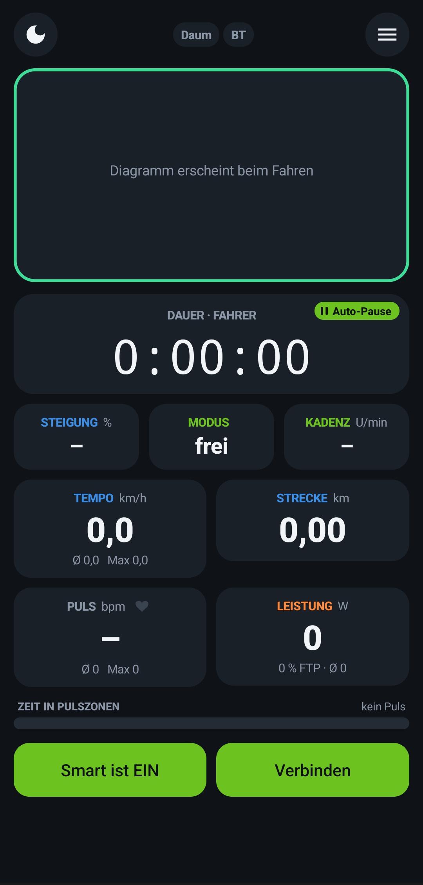
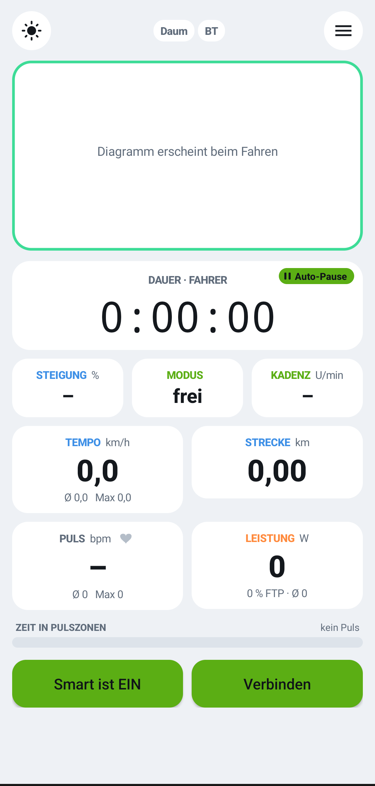
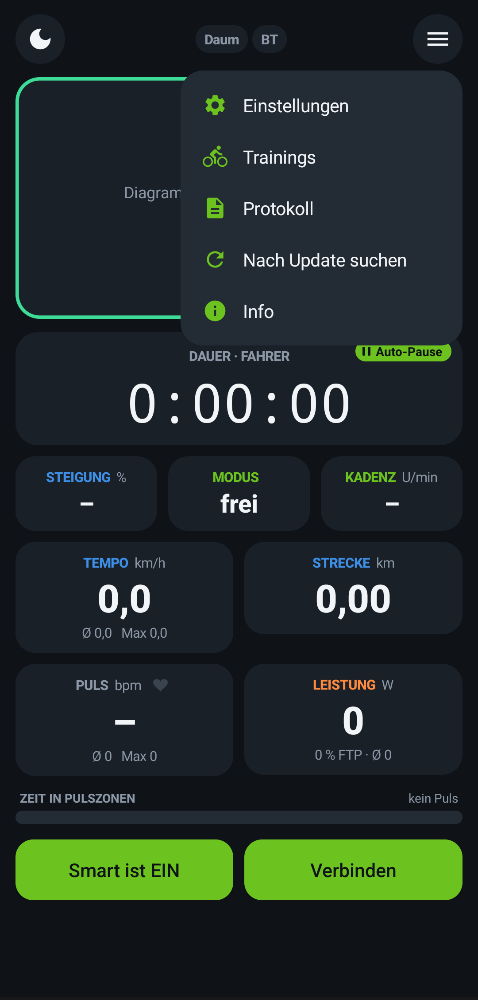
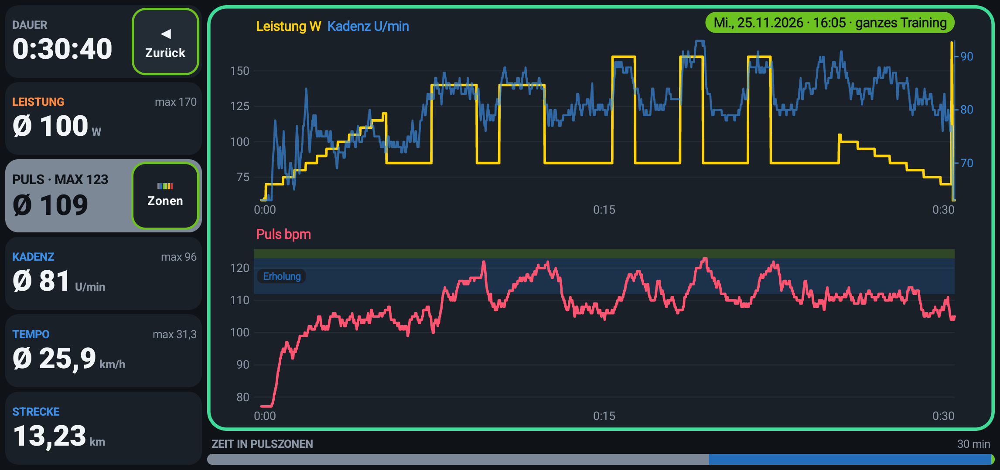
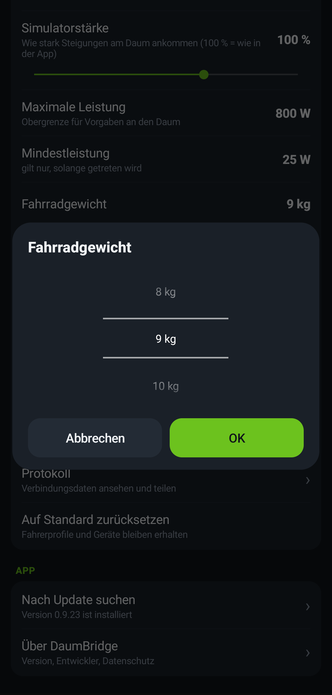
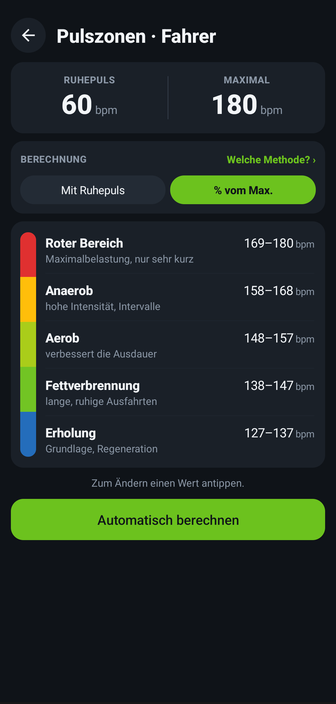
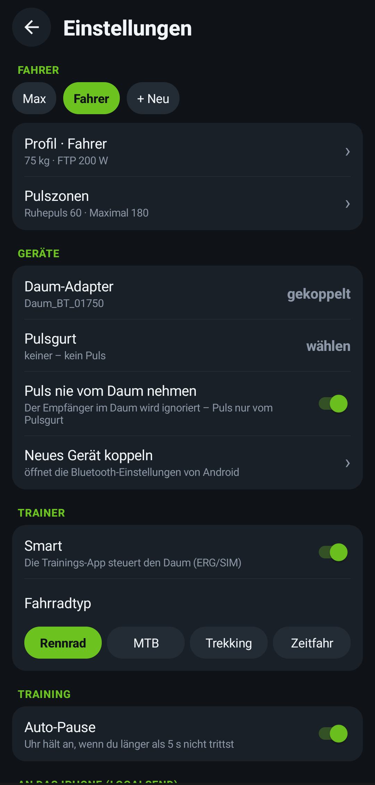
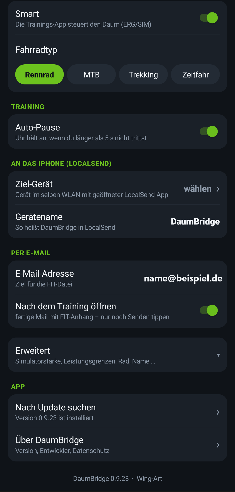
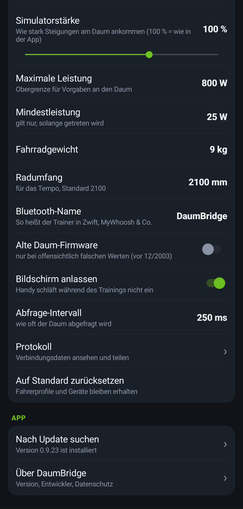

# DaumBridge – Anleitung

🇬🇧 **[English version](en/GUIDE.md)** · [← Zurück zur Übersicht](../README.md)

Stand: Version 0.9.23

**Inhalt:** [1. Installieren](#1-installieren) · [2. Daum-Adapter koppeln](#2-daum-adapter-koppeln-einmalig) · [3. Die Startseite](#3-die-startseite) · [4. Training](#4-training) · [5. Querformat](#5-querformat) · [6. Gespeicherte Trainings](#6-gespeicherte-trainings) · [7. Trainings weitergeben](#7-trainings-weitergeben) · [8. Mit der Trainings-App verbinden](#8-mit-der-trainings-app-verbinden) · [9. Pulsgurt](#9-pulsgurt-optional) · [10. Fahrerprofile](#10-fahrerprofile) · [11. Pulszonen](#11-pulszonen-und-zonenfarben) · [12. Smart, ERG und SIM](#12-smart-erg-und-sim) · [13. Einstellungen im Überblick](#13-einstellungen-im-überblick)

## 1. Installieren

1. Auf dem Android-Handy [DaumBridge.apk herunterladen](https://raw.githubusercontent.com/MAXimator70/daumbridge/main/DaumBridge.apk) (oder unter [Releases](https://github.com/MAXimator70/daumbridge/releases)).
2. Die Datei öffnen. Beim ersten Mal fragt Android, ob der Browser (oder Dateimanager) Apps installieren darf → **erlauben**, zurück, **Installieren**.
3. Beim ersten Start fragt DaumBridge nach **Bluetooth** („Geräte in der Nähe“) und **Benachrichtigungen** → beides erlauben. Ohne Bluetooth geht nichts; die Benachrichtigung zeigt, dass ein Training läuft.

**Updates:** DaumBridge meldet neue Versionen selbst. Von Hand: Menü ☰ → **Nach Update suchen**. Einstellungen, Profile und Trainings bleiben bei einem Update erhalten.

> Kommt beim Installieren auf älteren Handys die Meldung „Google Play Store angehalten“, ist das die Sicherheitsprüfung des Play Stores, nicht DaumBridge – siehe [FAQ](FAQ.md#installation).

## 2. Daum-Adapter koppeln (einmalig)

Kein originaler Daum-Adapter? Ein handelsüblicher Bluetooth-RS232-Adapter geht auch – siehe [Bluetooth-Adapter](ADAPTER.md).

1. Den Daum einschalten – der Bluetooth-Adapter muss am Daum stecken.
2. Am Handy **Android-Einstellungen → Bluetooth** öffnen (oder in DaumBridge: *Einstellungen → Geräte → Neues Gerät koppeln*).
3. Den Adapter in der Liste antippen (meist ein Name wie `Daum_BT_…`).
4. **PIN:** Fragt Android danach, ist es die 4-stellige Nummer, die auf dem Adapter steht. Manche Adapter koppeln ohne PIN – das ist normal.
5. Zurück in DaumBridge: **Menü ☰ → Einstellungen → Geräte → Daum-Adapter** und den Adapter auswählen.

## 3. Die Startseite

- **Oben links ☾ / ☀** schaltet zwischen dunkel und hell.
- **Chips in der Mitte:** **Daum** (Verbindung zum Ergometer), **BT** (Trainings-Apps, die verbunden sind; die Zahl zeigt wie viele) und **Puls** (Pulsgurt). Grau = aus, gelb = wird gesucht/aufgebaut, grün = verbunden. Antippen zeigt das Fenster **Verbindungen** mit allen Details.
- **Menü ☰ oben rechts:** Einstellungen, **Trainings** (gespeicherte Fahrten), Protokoll, Nach Update suchen, Info.
- **Diagramm-Karte:** zeigt beim Fahren Leistung, Kadenz und Puls der letzten 10 Minuten (siehe [Training](#4-training)). Einfaches Antippen dreht die Karte zum Logo und zurück.
- **Dauer-Karte:** Fahrzeit, dahinter der aktive Fahrer („DAUER · FAHRER“) – antippen wechselt den Fahrer, solange kein Training läuft. Rechts oben der Schalter **⏸ Auto-Pause**.
- **Kacheln:** Steigung, Modus (frei/ERG/SIM), Kadenz, Tempo, Strecke, Puls und Leistung, jeweils mit Ø und Max.
- **Zeit in Pulszonen:** Streifen mit den Anteilen der Pulszonen an der bisher gefahrenen Zeit.
- **Unten:** **Smart ist EIN/AUS** (siehe [Smart, ERG und SIM](#12-smart-erg-und-sim)) und **Verbinden** bzw. während des Trainings **Stopp**.

## 4. Training

1. Auf der Startseite **Verbinden** tippen. Der Chip **Daum** wird grün, sobald die Verbindung steht.
2. Der Chip **BT** wird grün, sobald eine Trainings-App verbunden ist.
3. Die **Uhr startet mit dem ersten Tritt** – vorher steht über der Zeit „WARTET AUF DEN ERSTEN TRITT“ (im Querformat „WARTET AUF 1. TRITT“) und es wird noch nichts aufgezeichnet. Du kannst also in Ruhe *Verbinden* tippen und erst später losfahren.
4. Die Diagramm-Karte zeigt **Leistung** (gelb) und **Kadenz** (blau) oben, **Puls** (rot) unten. Mit dem Finger nach rechts wischen blättert zurück, **Doppeltipp** springt wieder auf live.
5. **Auto-Pause:** Das Schild **⏸ Auto-Pause** in der Dauer-Karte schaltet sie ein (grün) oder aus (grau). Eingeschaltet hält die Uhr an, wenn du länger als 5 Sekunden nicht trittst – das Schild zeigt dann gelb **PAUSE**, die Zeit wird gelb. Pausen zählen nicht in Dauer, Durchschnitte, Zonenzeit und FIT-Datei.
6. Fertig? **Stopp** tippen – danach erscheint die **Zusammenfassung** (Dauer, Strecke, Leistung, Normalized Power, Arbeit in kJ, Puls, Zeit in Pulszonen).
7. In der Zusammenfassung: **Training teilen (FIT) …**, **An … senden (LocalSend)** und – wenn eingestellt – **Per E-Mail**. Die Zusammenfassung bleibt beim Teilen offen.

**So liest du das Diagramm:**
- Die Skalen passen sich automatisch an: **Leistung** (Skala links), **Kadenz** (eigene blaue Skala rechts) und **Puls** füllen jeweils rund **80 %** ihrer Fläche – auch kleine Unterschiede sind gut sichtbar. Wenn sich die Werte ändern, gleitet die Skala weich mit.
- Kurzes Anfahren und Ausrollen (0 W, 0 U/min) und einzelne Ausreißer verzerren die Skala nicht.
- Die **Kadenz** liegt halbtransparent **vor** der Leistung und ist im Diagramm über 5 Sekunden geglättet. Die Zahl in der Kachel und die FIT-Datei bleiben ungeglättet.

Bricht die Verbindung zum Daum ab (Adapter kurz aus, außer Reichweite), wird der Chip **Daum** gelb und DaumBridge verbindet sich selbst neu. Das Training läuft weiter.

## 5. Querformat

Handy quer drehen – das Training läuft einfach weiter.

- **Links** eine schmale Spalte mit allen Werten übereinander in großen, fetten Zahlen: Dauer, Leistung (mit % FTP), Puls, Kadenz (mit Ø), Tempo (mit Ø), Strecke.
- **Rechts** das große Diagramm (vier Fünftel der Breite) mit den **Pulszonen als farbigen Bändern** hinter dem Puls. Ein Punkt markiert die aktuelle Position, das Diagramm läuft mit.
- **Zoomen** mit zwei Fingern (1 bis 30 Minuten), **wischen** blättert zurück, **Doppeltipp** beendet Zoom und Zurückblättern. Ein grünes Schild oben rechts zeigt, wenn gezoomt oder zurückgeblättert ist.
- **Puls-Kachel:** färbt sich in der aktuellen Pulszone und zeigt deren Namen (z. B. „Z2 · FETTVERBRENNUNG“). Der Puls steht ohne „bpm“, damit die Zahl groß bleibt. Daneben das **♥** im Pulstakt und die **Batterie** des Gurts (nur als Farbe).
- **Quadratische Knöpfe:** **Auto-Pause** (in der Dauer-Kachel) und **Zonen** (in der Puls-Kachel) – *Zonen* blendet den Streifen **Zeit in Pulszonen** unten ein oder aus; ohne Streifen wird das Diagramm größer.
- **Zeit in Pulszonen** nutzt immer die ganze Breite und zeigt die Anteile an der bisher gefahrenen Zeit; rechts steht die Fahrzeit. Beim Zoomen bleibt der Streifen unverändert.
- Hochkant drehen = zurück zur normalen Ansicht.

## 6. Gespeicherte Trainings

Jedes Training ab 30 Sekunden bleibt auf dem Handy gespeichert – bis du es löschst oder die App deinstallierst.

**Menü ☰ → Trainings** listet alle Fahrten (neueste oben) mit Datum, Dauer, Strecke, Ø-Leistung, Ø-Puls und Fahrer. Bereits geteilte Trainings haben ein **✓** mit der App, an die geteilt wurde. Ein Training antippen bietet:

| Eintrag | Was passiert |
|---|---|
| **Diagramm ansehen** | öffnet das Training im Querformat (siehe unten) |
| **Teilen …** | Teilen-Menü von Android: Telegram, Google Drive, Dropbox, Synology, MaxUp … |
| **An … senden** | per LocalSend ans iPhone; ist noch kein Gerät gewählt: **An iPhone senden – Ziel wählen** |
| **Per E-Mail** | nur wenn eine Adresse eingestellt ist |
| **Löschen** (rot) | mit Rückfrage, lässt sich nicht rückgängig machen |

**Aufräumen** (rot, unter der Liste) löscht mehrere auf einmal: älter als 3 Monate, älter als 1 Jahr, alle bereits geteilten oder alle – immer mit Rückfrage und Hinweis, wenn noch nicht geteilte dabei sind.

### Diagramm ansehen

Das Training öffnet sich in der gewohnten **Querformat-Ansicht** – das Handy dreht sich dafür automatisch quer:

- **Links:** Dauer mit **◀ Zurück**, **Ø-Leistung**, **Ø-Puls**, **Ø-Kadenz**, **Ø-Tempo** jeweils mit Maximalwert, und die Strecke. Die Puls-Kachel hat die Farbe der Zone, in die der Durchschnittspuls fällt.
- **Rechts:** Leistung, Kadenz und Puls über das **ganze Training**, mit Auto-Zoom und Pulszonen-Bändern. Oben steht ein Schild mit Datum und Uhrzeit.
- **Unten:** Zeit in Pulszonen fürs ganze Training (Knopf **Zonen** blendet ihn aus).
- Zwei Finger = zoomen, wischen = blättern, Doppeltipp = wieder das ganze Training.
- Die Pulszonen kommen vom Fahrer, der das Training gefahren ist. Das funktioniert auch mit älteren Trainings, weil alles direkt aus der gespeicherten FIT-Datei gelesen wird.

## 7. Trainings weitergeben

Die FIT-Datei enthält Leistung, Kadenz, Puls, Tempo und Strecke **Sekunde für Sekunde** – MaxUp, Strava, Garmin Connect, Intervals.icu, TrainingPeaks & Co. zeichnen daraus beim Import ihre eigenen Diagramme.

### Ans iPhone (LocalSend)

DaumBridge schickt Trainings direkt an ein Gerät im selben WLAN, auf dem die kostenlose App **LocalSend** läuft – z. B. ein iPhone. Auf dem Android-Handy ist keine zusätzliche App nötig.

1. Auf dem iPhone **LocalSend** aus dem App Store installieren, öffnen und „Lokales Netzwerk“ erlauben. Tipp: in LocalSend **Schnellspeichern** einschalten, dann ist kein Annehmen nötig.
2. In DaumBridge: **Einstellungen → An das iPhone (LocalSend) → Ziel-Gerät** – DaumBridge sucht im WLAN, iPhone antippen. Alternativ direkt beim Senden: Ist noch kein Ziel gewählt, steht dort **An iPhone senden – Ziel wählen** und öffnet dieselbe Geräteauswahl.
3. **Nach dem Training senden** eingeschaltet: Beim Stopp geht die FIT-Datei automatisch ans iPhone. Die Zusammenfassung zeigt „Sende …“, „✓ gesendet“ oder einen Hinweis, falls das iPhone nicht erreichbar war.
4. Auf dem iPhone liegt die Datei in der **Dateien**-App im Ordner LocalSend – antippen, teilen, z. B. an MaxUp.

LocalSend muss auf dem Empfänger **geöffnet** sein, wenn gesendet wird. Das Ziel-Gerät wird **pro Handy** gespeichert – fahren mehrere mit eigenem Handy, richtet jeder es einmal ein. Klappt das Senden nicht (vor allem von älteren Handys mit Android 7): in LocalSend am iPhone unter Einstellungen **Verschlüsselung** ausschalten.

### Per E-Mail

**Einstellungen → Per E-Mail → E-Mail-Adresse** eintragen. Dann gibt es in der Zusammenfassung und unter Menü ☰ → *Trainings* den Eintrag **Per E-Mail**: Die Mail-App öffnet sich mit Empfänger, Betreff, Kennzahlen und der FIT-Datei im Anhang – nur noch **Senden** tippen. Mit **Nach dem Training öffnen** geht die fertige Mail beim Stopp von selbst auf.

### Teilen

**Training teilen (FIT) …** bzw. **Teilen …** öffnet das Teilen-Menü von Android – jede App, die Dateien annimmt (Telegram, Google Drive, Dropbox, Synology Drive, MaxUp …).

## 8. Mit der Trainings-App verbinden

DaumBridge erscheint in der Trainings-App als Smart-Trainer mit dem Namen **DaumBridge** (änderbar unter *Einstellungen → Erweitert → Bluetooth-Name*). Manche Apps hängen eine Nummer an, z. B. „DaumBridge-4874“ – das ist richtig so.

### Zwift
*Gepaarte Geräte* → bei **Leistung**, **Trittfrequenz** und **Steuerbarer Trainer** jeweils **DaumBridge** wählen.

### MyWhoosh
*Geräte verbinden* → **Smart Trainer** → **DaumBridge**. Trittfrequenz kommt automatisch mit.

### Apple TV
Wie bei Zwift. Hinweis: Apple TV verbindet höchstens **zwei Bluetooth-Geräte** gleichzeitig (Fernbedienung zählt mit). Den Pulsgurt deshalb über DaumBridge laufen lassen (siehe unten) – dann reicht eine Verbindung.

### Puls in der Trainings-App
Kommt der Puls über DaumBridge, in der Trainings-App bei **Herzfrequenz** ebenfalls **DaumBridge** wählen.

## 9. Pulsgurt (optional)

DaumBridge verbindet sich selbst mit einem Bluetooth-Pulsgurt (z. B. Polar H9/H10, Garmin, Wahoo), zeigt den Puls an und gibt ihn an die Trainings-App weiter.

1. Den Gurt anlegen (Kontakte leicht befeuchten), damit er sendet.
2. DaumBridge → *Einstellungen → Geräte → Pulsgurt* → **Pulsgurt suchen** → Gurt antippen.

**Trennen:** *Einstellungen → Geräte → Pulsgurt* → **Pulsgurt trennen** (roter Knopf) oder oben auf die Chips tippen → *Verbindungen* → **Pulsgurt trennen**. Der Gurt ist dann sofort frei für Uhr oder andere Geräte.

Koppeln in den Android-Einstellungen ist nicht nötig – viele Gurte lehnen das sogar ab („Kopplung abgelehnt“). Bis Android 11 fragt Android für die Suche einmal nach dem **Standort** und der Standort muss eingeschaltet sein; DaumBridge nutzt ihn nicht.

Sobald die App offen ist, verbindet sie sich mit dem Gurt – der Puls steht schon **vor dem Start** in der Kachel. Ist die App im Hintergrund und läuft kein Training, trennt sie den Gurt nach 20 Sekunden wieder.

**Herz und Akku:** Das **♥** in der Puls-Kachel ist **rot** und schlägt im Takt deines Pulses, sobald Werte kommen, **gelb**, solange der Gurt gesucht wird, und **grau**, wenn kein Gurt verbunden ist. Der Chip **Puls** oben zeigt dasselbe (grün/gelb/grau). Eine senkrechte **Batterie** zeigt den Akkustand des Gurts – grün, unter 20 % gelb, unter 10 % rot; unter 15 % erscheint beim Verbinden einmal ein Hinweis. Gurte, die keinen Akkustand melden, zeigen keine Batterie.

**Puls nie vom Daum nehmen:** Dieser Schalter unter *Einstellungen → Geräte* ist **ab Werk an**. Der ungenaue Pulsempfänger im Daum wird dann ignoriert, der Puls kommt nur vom Bluetooth-Gurt; ohne Gurt bleibt die Puls-Kachel leer. Nur wer ohne Gurt trotzdem den Daum-Puls möchte, schaltet ihn aus.

Offensichtliche Messfehler (z. B. 199 bpm im Sitzen bei schlechtem Hautkontakt oder sprunghafte Ausreißer) filtert DaumBridge heraus. Springt der Puls trotzdem stark: Elektroden anfeuchten, Gurt enger stellen, Batterie prüfen.

Wichtig: Viele Gurte (z. B. **Polar H9**) erlauben nur **eine** Bluetooth-Verbindung. Ist der Gurt schon mit Laptop, Uhr oder Trainings-App verbunden, bekommt DaumBridge keine Werte – dort also trennen.

## 10. Fahrerprofile

Fahren mehrere Personen, bekommt jede ein eigenes Profil mit Geburtsdatum, Gewicht, FTP, Pulsgurt, Pulszonen und Simulatorstärke.

- *Einstellungen → Fahrer* → **+ Neu** legt ein Profil an.
- Auf ein Profil tippen wählt es aus; das aktive Profil nochmal antippen → **umbenennen** oder **löschen**.
- **Profil ›** öffnet eine eigene Seite mit Name, Geburtsdatum, Geschlecht, Gewicht und FTP.
- Auf der Startseite steht der aktive Fahrer bei der **Dauer**. Antippen wechselt den Fahrer (wenn kein Training läuft).

Werte stellst du mit **Drehrädern** ein – keine Tastatur nötig:

## 11. Pulszonen und Zonenfarben

*Einstellungen → Pulszonen* zeigt Ruhepuls, Maximalpuls und die fünf Zonen:

| Zone | Farbe | Bedeutung |
|---|---|---|
| Erholung | blau | Grundlage, Regeneration |
| Fettverbrennung | grün | lange, ruhige Ausfahrten |
| Aerob | gelbgrün | verbessert die Ausdauer |
| Anaerob | gelb | hohe Intensität, Intervalle |
| Roter Bereich | rot | Maximalbelastung, nur sehr kurz |

Unterhalb der Erholungszone ist **grau**.

- **Berechnung – zwei Methoden** (umschaltbar, die Zonen rechnen sofort neu):
  - **Mit Ruhepuls (Karvonen):** Untergrenzen = Ruhepuls + 50 / 60 / 70 / 80 / 90 % der Pulsreserve (Maximalpuls − Ruhepuls). Berücksichtigt die Fitness – am besten, wenn du deinen Ruhepuls kennst (morgens im Liegen messen).
  - **% vom Max.:** Untergrenzen = 70,5 / 76,5 / 82 / 88 / 94 % vom Maximalpuls. Einfach, braucht nur den Maximalpuls.
  - *Welche Methode? ›* auf der Zonen-Seite erklärt beide.
- Änderst du Ruhe- oder Maximalpuls, werden die Zonen nach der gewählten Methode neu berechnet.
- **Automatisch berechnen:** berechnet die Zonen nach der gewählten Methode. Ist ein Geburtsdatum hinterlegt, schlägt DaumBridge einen Maximalpuls aus dem Alter vor.
- **Selbst einstellen:** Jeden Wert antippen und per Drehrad ändern. Ein gemessener Maximalpuls (Leistungstest, Pulsuhr) ist genauer als die Schätzung.

Beim Fahren färben sich die Kacheln **Puls** und **Leistung** nach Zone. Die Leistungszonen richten sich nach der **FTP** im Profil. Der Streifen **Zeit in Pulszonen** nutzt immer die ganze Breite und zeigt die Anteile der Zonen an der bisher gefahrenen Zeit.

## 12. Smart, ERG und SIM

- **Smart EIN:** Die Trainings-App steuert den Daum – im **ERG**-Modus gibt sie Watt vor, im **SIM**-Modus Steigungen. Der Drehknopf am Daum wird dann überstimmt. Die Kachel **Modus** zeigt, was gerade gilt.
- **Smart AUS:** DaumBridge misst nur; die Leistung stellst du am Daum selbst ein.
- **Simulatorstärke** (*Erweitert*): 100 % = Steigungen wie in der App, 50 % = halb so steil. Achtung: Zwift hat einen eigenen Regler „Trainer-Schwierigkeit“ – beide wirken zusammen.
- **Fahrradtyp** (Rennrad, MTB, Trekking, Zeitfahr) bestimmt Roll- und Luftwiderstand, falls die App keine eigenen Werte schickt.

## 13. Einstellungen im Überblick

| Bereich | Einstellungen |
|---|---|
| **Fahrer** | Profile wählen, anlegen (+ Neu), umbenennen, löschen; *Profil ›* (Name, Geburtsdatum, Geschlecht, Gewicht, FTP); *Pulszonen ›* |
| **Geräte** | Daum-Adapter, Pulsgurt (suchen, wählen, trennen), **Puls nie vom Daum nehmen** (ab Werk an), Neues Gerät koppeln |
| **Trainer** | **Smart** ein/aus, **Fahrradtyp** |
| **Training** | **Auto-Pause** |
| **An das iPhone (LocalSend)** | Ziel-Gerät, Nach dem Training senden, Gerätename (so heißt DaumBridge in LocalSend) |
| **Per E-Mail** | E-Mail-Adresse, Nach dem Training öffnen |
| **Erweitert** | Simulatorstärke, maximale und minimale Leistung, Fahrradgewicht, Radumfang (für das Tempo, Standard 2100 mm), Bluetooth-Name, alte Daum-Firmware, Bildschirm anlassen, Abfrage-Intervall, Protokoll, *Auf Standard zurücksetzen* (Profile und Geräte bleiben erhalten) |
| **App** | Nach Update suchen, Über DaumBridge |

---
Probleme? → [Häufige Fragen und Fehlerbehebung](FAQ.md) · Alle Änderungen: [Versionen](../Versionen.md)
