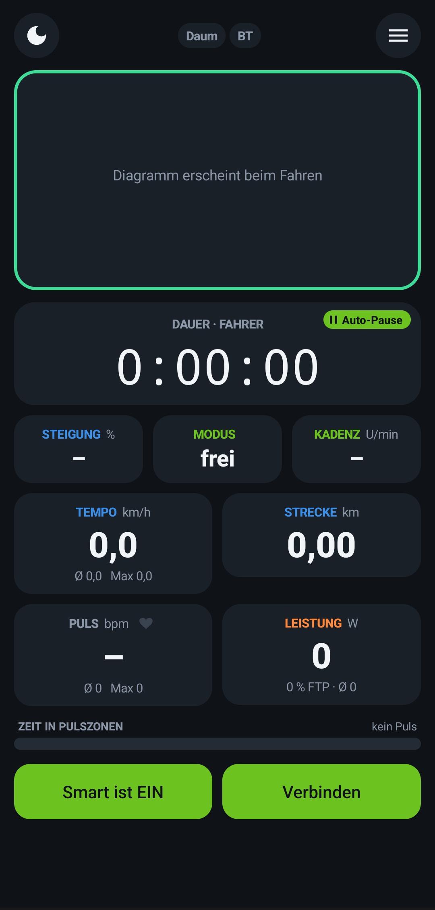
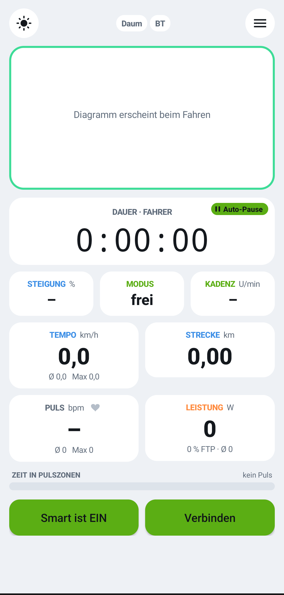
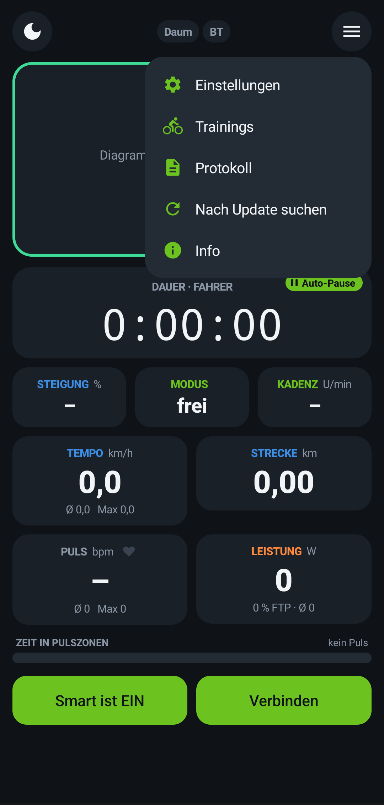
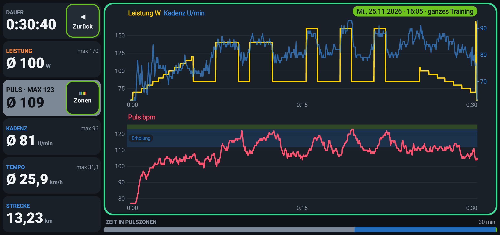
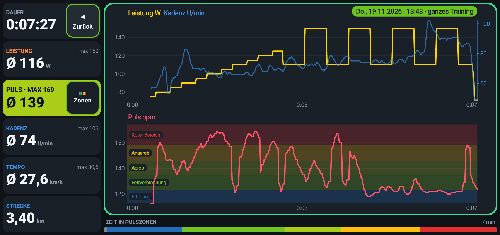
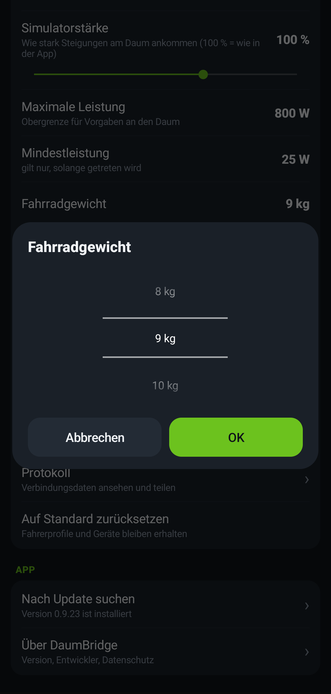
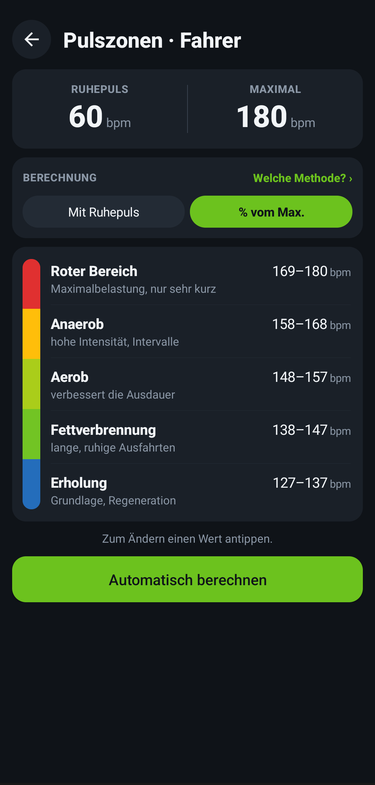
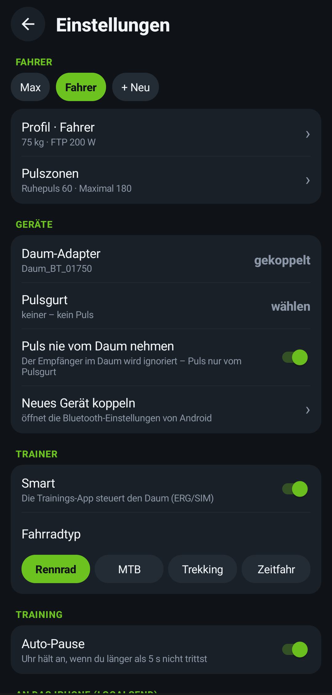
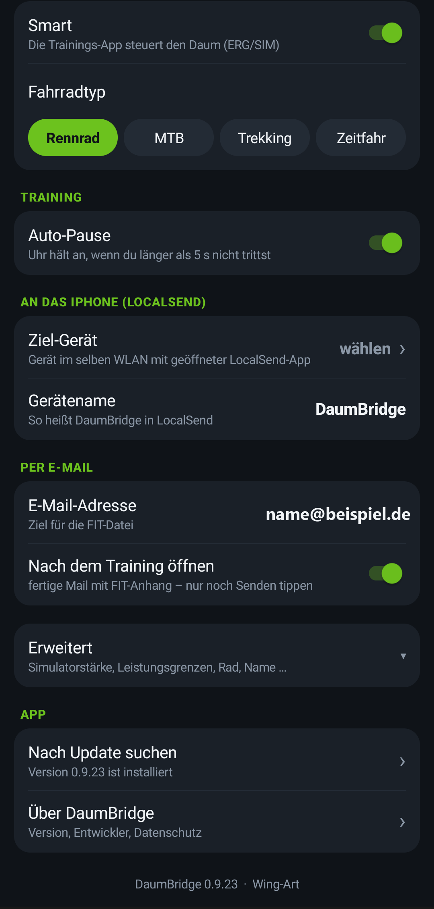
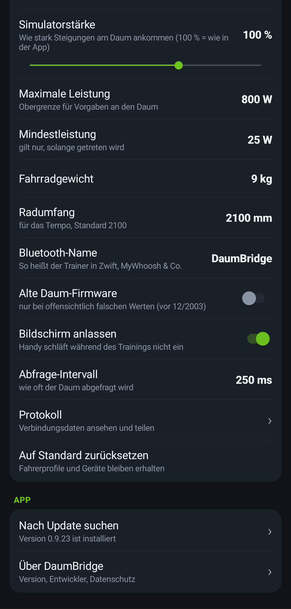

# DaumBridge – User guide

🇩🇪 **[Deutsche Version](../ANLEITUNG.md)** · [← Back to overview](../../README.en.md)

Version 0.9.23. The app itself is in German; German labels are shown in *italics* or **bold** with a translation where helpful.

**Contents:** [1. Install](#1-install) · [2. Pair the Daum adapter](#2-pair-the-daum-adapter-once) · [3. Home screen](#3-home-screen) · [4. Riding](#4-riding) · [5. Landscape](#5-landscape) · [6. Saved rides](#6-saved-rides) · [7. Sharing rides](#7-sharing-rides) · [8. Connect your training app](#8-connect-your-training-app) · [9. Heart rate strap](#9-heart-rate-strap-optional) · [10. Rider profiles](#10-rider-profiles) · [11. Heart rate zones](#11-heart-rate-zones-and-zone-colours) · [12. Smart, ERG and SIM](#12-smart-erg-and-sim) · [13. Settings overview](#13-settings-overview)

## 1. Install

1. On your Android phone [download DaumBridge.apk](https://raw.githubusercontent.com/MAXimator70/daumbridge/main/DaumBridge.apk) (or from [Releases](https://github.com/MAXimator70/daumbridge/releases)).
2. Open the file. The first time, Android asks whether the browser (or file manager) may install apps → **allow**, go back, **Install**.
3. On first launch DaumBridge asks for **Bluetooth** (“Nearby devices”) and **Notifications** → allow both. Nothing works without Bluetooth; the notification shows that a ride is running.

**Updates:** DaumBridge announces new versions itself. Manually: menu ☰ → **Nach Update suchen** (check for updates). Settings, profiles and rides are kept when updating.

> If older phones show “Google Play Store has stopped” while installing, that's the Play Store's security check, not DaumBridge – see the [FAQ](FAQ.md#installation).

## 2. Pair the Daum adapter (once)

No original Daum adapter? A standard Bluetooth RS232 adapter works too – see [Bluetooth adapter](ADAPTER.md).

1. Switch on the Daum – the Bluetooth adapter must be plugged into the Daum.
2. On the phone open **Android settings → Bluetooth** (or in DaumBridge: *Einstellungen → Geräte → Neues Gerät koppeln* – Settings → Devices → Pair new device).
3. Tap the adapter in the list (usually named like `Daum_BT_…`).
4. **PIN:** if Android asks, it's the 4-digit number printed on the adapter. Some adapters pair without a PIN – that's normal.
5. Back in DaumBridge: **menu ☰ → Einstellungen → Geräte → Daum-Adapter** and pick the adapter.

## 3. Home screen

- **Top left ☾ / ☀** switches between dark and light.
- **Chips in the middle:** **Daum** (connection to the ergometer), **BT** (connected training apps; the number shows how many) and **Puls** (heart rate strap). Grey = off, yellow = searching/connecting, green = connected. Tapping one opens the **Verbindungen** (connections) window with all details.
- **Menu ☰ top right:** *Einstellungen* (settings), **Trainings** (saved rides), *Protokoll* (log), *Nach Update suchen* (check for updates), *Info*.
- **Chart card:** while riding it shows power, cadence and heart rate of the last 10 minutes (see [Riding](#4-riding)). A single tap flips the card to the logo and back.
- **Duration card:** riding time, followed by the active rider (“DAUER · name”) – tap to switch rider while no ride is running. Top right the **⏸ Auto-Pause** switch.
- **Tiles:** grade (*Steigung*), mode (*Modus*: free/ERG/SIM), cadence (*Kadenz*), speed (*Tempo*), distance (*Strecke*), heart rate (*Puls*) and power (*Leistung*), each with average (Ø) and maximum.
- **Zeit in Pulszonen** (time in heart-rate zones): bar with each zone's share of the time ridden so far.
- **Bottom:** **Smart ist EIN/AUS** (smart on/off, see [Smart, ERG and SIM](#12-smart-erg-and-sim)) and **Verbinden** (connect), during a ride **Stopp**.

## 4. Riding

1. Tap **Verbinden** (connect) on the home screen. The **Daum** chip turns green once connected.
2. The **BT** chip turns green once a training app is connected.
3. The **clock starts with your first pedal stroke** – until then the duration shows “WARTET AUF DEN ERSTEN TRITT” (waiting for the first pedal stroke) and nothing is recorded. So you can tap *Verbinden* and get going later.
4. The chart card shows **power** (yellow) and **cadence** (blue) at the top, **heart rate** (red) below. Swipe right to scroll back, **double-tap** returns to live.
5. **Auto-pause:** the **⏸ Auto-Pause** pill in the duration card turns it on (green) or off (grey). When on, the clock stops if you don't pedal for more than 5 seconds – the pill shows yellow **PAUSE** and the time turns yellow. Pauses don't count towards duration, averages, zone time or the FIT file.
6. Done? Tap **Stopp** – the **summary** appears (duration, distance, speed, power, normalized power, work in kJ, heart rate, time in zones).
7. In the summary: **Training teilen (FIT) …** (share), **An … senden (LocalSend)** and – if set up – **Per E-Mail**. The summary stays open while sharing.

**Reading the chart:**
- The scales adjust automatically: **power** (left scale), **cadence** (its own blue scale on the right) and **heart rate** each fill about **80 %** of their area, so even small changes are visible. When the values change, the scale glides smoothly.
- Short starts and stops (0 W, 0 rpm) and single outliers don't distort the scale.
- **Cadence** is drawn semi-transparent **in front of** power and smoothed over 5 seconds in the chart. The number in the tile and the FIT file stay unsmoothed.

If the connection to the Daum drops (adapter switched off, out of range), the **Daum** chip turns yellow and DaumBridge reconnects by itself. The ride keeps going.

## 5. Landscape

Turn the phone sideways – the ride simply continues.

- **Left:** a narrow column with all values stacked in large bold numbers: duration, power (with % FTP), heart rate, cadence (with average), speed (with average), distance.
- **Right:** the large chart (four fifths of the width) with the **heart-rate zones as coloured bands** behind the heart rate. A dot marks the current position; the chart scrolls along.
- **Zoom** with two fingers (1 to 30 minutes), **swipe** to scroll back, **double-tap** ends zoom and scrolling. A green label at the top right shows when zoomed or scrolled.
- **Heart-rate tile:** takes on the colour of the current zone and shows its name (e.g. “Z2 · FETTVERBRENNUNG”). Heart rate is shown without “bpm” so the number stays large. Next to it the **♥** beating with your pulse and the strap **battery** (colour only).
- **Square buttons:** **Auto-Pause** (in the duration tile) and **Zonen** (in the heart-rate tile) – *Zonen* shows or hides the **Zeit in Pulszonen** bar at the bottom; without it the chart gets bigger.
- **Zeit in Pulszonen** always uses the full width and shows each zone's share of the time ridden so far; the riding time is shown on the right. It doesn't change when zooming.
- Turn upright = back to the normal view.

## 6. Saved rides

Every ride of 30 seconds or more stays saved on the phone – until you delete it or uninstall the app.

**Menu ☰ → Trainings** lists all rides (newest first) with date, duration, distance, average power, average heart rate and rider. Rides already shared show a **✓** with the app they were shared to. Tap a ride for:

| Entry | What it does |
|---|---|
| **Diagramm ansehen** (view chart) | opens the ride in landscape (see below) |
| **Teilen …** (share) | Android share menu: Telegram, Google Drive, Dropbox, Synology, MaxUp … |
| **An … senden** (send to …) | via LocalSend to the iPhone; if no device is chosen yet: **An iPhone senden – Ziel wählen** (choose target) |
| **Per E-Mail** | only if an address is set |
| **Löschen** (delete, red) | asks first, cannot be undone |

**Aufräumen** (clean up, red, below the list) deletes several at once: older than 3 months, older than 1 year, all already shared, or all – always asking first and warning if unshared rides are included.

### View chart

The ride opens in the familiar **landscape view** – the phone switches to landscape automatically:

- **Left:** duration with **◀ Zurück** (back), **average power**, **heart rate**, **cadence** and **speed**, each with its maximum, and the distance. The heart-rate tile takes the colour of the zone the average falls into.
- **Right:** power, cadence and heart rate over the **whole ride**, with auto-zoom and zone bands. A label at the top shows date and time.
- **Bottom:** time in heart-rate zones for the whole ride (the **Zonen** button hides it).
- Two fingers = zoom, swipe = scroll, double-tap = whole ride again.
- The zones are taken from the rider who did the ride. This also works for older rides because everything is read straight from the saved FIT file.

## 7. Sharing rides

The FIT file contains power, cadence, heart rate, speed and distance **second by second** – MaxUp, Strava, Garmin Connect, Intervals.icu, TrainingPeaks and others draw their own charts from it on import.

### To an iPhone (LocalSend)

DaumBridge sends rides straight to a device on the same Wi-Fi running the free app **LocalSend** – e.g. an iPhone. No extra app is needed on the Android phone.

1. On the iPhone install **LocalSend** from the App Store, open it and allow “Local Network”. Tip: turn on **Quick Save** in LocalSend so no accepting is needed.
2. In DaumBridge: **Settings → An das iPhone (LocalSend) → Ziel-Gerät** (target device) – DaumBridge searches the Wi-Fi, tap your iPhone. Or right when sending: if no target is chosen yet, the entry reads **An iPhone senden – Ziel wählen** and opens the same device picker.
3. With **Nach dem Training senden** (send after the ride) on, the FIT file goes to the iPhone automatically on stop. The summary shows sending, “✓ gesendet” (sent) or a hint if the iPhone wasn't reachable.
4. On the iPhone the file is in the **Files** app in the LocalSend folder – tap it, share, e.g. to MaxUp.

LocalSend has to be **open** on the receiving device while sending. The target device is stored **per phone** – if several people ride with their own phones, each sets it up once. If sending fails (especially from older phones with Android 7): on the iPhone, turn off **Encryption** in the LocalSend settings.

### By e-mail

Enter an address under **Settings → Per E-Mail → E-Mail-Adresse**. The summary and menu ☰ → *Trainings* then offer **Per E-Mail**: your mail app opens with recipient, subject, key figures and the FIT file attached – just tap **Send**. With **Nach dem Training öffnen** (open after the ride) the mail opens by itself on stop.

### Share

**Training teilen (FIT) …** or **Teilen …** opens the Android share menu – any app that accepts files (Telegram, Google Drive, Dropbox, Synology Drive, MaxUp …).

## 8. Connect your training app

DaumBridge appears in the training app as a smart trainer named **DaumBridge** (change it under *Einstellungen → Erweitert → Bluetooth-Name*). Some apps add a number, e.g. “DaumBridge-4874” – that's fine.

### Zwift
*Paired Devices* → choose **DaumBridge** for **Power**, **Cadence** and **Controllable**.

### MyWhoosh
*Connect devices* → **Smart Trainer** → **DaumBridge**. Cadence comes along automatically.

### Apple TV
As with Zwift. Note: Apple TV connects at most **two Bluetooth devices** at once (the remote counts). So let the heart rate strap run through DaumBridge (see below) – then one connection is enough.

### Heart rate in the training app
If heart rate comes via DaumBridge, choose **DaumBridge** for **Heart Rate** in the training app as well.

## 9. Heart rate strap (optional)

DaumBridge connects to a Bluetooth heart rate strap itself (e.g. Polar H9/H10, Garmin, Wahoo), shows the heart rate and passes it on to the training app.

1. Put on the strap (moisten the contacts slightly) so it starts sending.
2. DaumBridge → *Einstellungen → Geräte → Pulsgurt* → **Pulsgurt suchen** (search) → tap the strap.

**Disconnect:** *Einstellungen → Geräte → Pulsgurt* → **Pulsgurt trennen** (red button), or tap the chips at the top → *Verbindungen* → **Pulsgurt trennen**. The strap is then free for your watch or other devices.

Pairing in Android settings isn't needed – many straps even refuse it (“pairing rejected”). Up to Android 11, Android asks once for **location** permission for the search and location must be switched on; DaumBridge doesn't use it.

As soon as the app is open it connects to the strap – the heart rate shows in the tile **before you start**. If the app is in the background and no ride is running, it disconnects the strap after 20 seconds.

**Heart and battery:** the **♥** in the heart-rate tile is **red** and beats in time with your pulse once values arrive, **yellow** while the strap is being searched for, and **grey** when no strap is connected. The **Puls** chip at the top shows the same (green/yellow/grey). A vertical **battery** shows the strap's charge – green, yellow below 20 %, red below 10 %; below 15 % a one-time hint appears on connecting. Straps that don't report their battery show no battery.

**Puls nie vom Daum nehmen** (never take heart rate from the Daum): this switch under *Einstellungen → Geräte* is **on by default**. The Daum's inaccurate heart rate receiver is ignored and heart rate comes only from the Bluetooth strap; without a strap the heart-rate tile stays empty. Only if you have no strap and still want the Daum's value, turn it off.

Obvious measuring errors (e.g. 199 bpm while sitting due to poor skin contact, or sudden spikes) are filtered out. If the heart rate still jumps a lot: moisten the electrodes, tighten the strap, check the battery.

Important: many straps (e.g. **Polar H9**) allow only **one** Bluetooth connection. If the strap is already connected to a laptop, watch or the training app, DaumBridge gets no values – disconnect it there.

## 10. Rider profiles

If several people ride, each gets their own profile with date of birth, weight, FTP, heart rate strap, heart rate zones and simulator strength.

- *Einstellungen → Fahrer* (riders) → **+ Neu** creates a profile.
- Tap a profile to select it; tap the active profile again → **rename** or **delete**.
- **Profil ›** opens a page with name, date of birth, sex, weight and FTP.
- On the home screen the active rider is shown with the **duration**. Tap it to switch riders (when no ride is running).

Values are set with **scroll wheels** – no keyboard needed:

## 11. Heart rate zones and zone colours

*Einstellungen → Pulszonen* shows resting heart rate, maximum heart rate and the five zones:

| Zone | Colour | Meaning |
|---|---|---|
| Erholung (recovery) | blue | base, regeneration |
| Fettverbrennung (fat burning) | green | long, easy rides |
| Aerob (aerobic) | yellow-green | improves endurance |
| Anaerob (anaerobic) | yellow | high intensity, intervals |
| Roter Bereich (red zone) | red | maximum effort, very short only |

Below the recovery zone is **grey**.

- **Calculation – two methods** (switchable, zones recalculate instantly):
  - **Mit Ruhepuls (Karvonen, with resting HR):** lower limits = resting HR + 50 / 60 / 70 / 80 / 90 % of the heart rate reserve (max HR − resting HR). Takes fitness into account – best if you know your resting heart rate (measure in the morning lying down).
  - **% vom Max. (% of max):** lower limits = 70.5 / 76.5 / 82 / 88 / 94 % of max heart rate. Simple, needs only the max heart rate.
  - *Welche Methode? ›* (which method?) on the zones page explains both.
- If you change resting or max heart rate, the zones are recalculated with the selected method.
- **Automatisch berechnen** (calculate automatically): calculates the zones with the selected method. If a date of birth is set, DaumBridge suggests a max heart rate from your age.
- **Set them yourself:** tap any value and change it with the scroll wheel. A measured max heart rate (performance test, heart rate watch) is more accurate than the estimate.

While riding, the **Puls** (heart rate) and **Leistung** (power) tiles change colour by zone. Power zones are based on the **FTP** in your profile. The **Zeit in Pulszonen** bar always uses the full width and shows each zone's share of the time ridden so far.

## 12. Smart, ERG and SIM

- **Smart EIN (on):** the training app controls the Daum – in **ERG** mode it sets watts, in **SIM** mode gradients. The knob on the Daum is overridden. The **Modus** tile shows what's active.
- **Smart AUS (off):** DaumBridge only measures; you set the resistance on the Daum yourself.
- **Simulatorstärke** (simulator strength, under *Erweitert*): 100 % = gradients as in the app, 50 % = half as steep. Note: Zwift has its own “Trainer Difficulty” slider – both act together.
- **Fahrradtyp** (bike type: road, MTB, trekking, time trial) sets rolling and air resistance if the app doesn't send its own values.

## 13. Settings overview

| Section | Settings |
|---|---|
| **Fahrer** (riders) | select, create (+ Neu), rename, delete profiles; *Profil ›* (name, date of birth, sex, weight, FTP); *Pulszonen ›* |
| **Geräte** (devices) | Daum adapter, heart rate strap (search, choose, disconnect), **Puls nie vom Daum nehmen** (on by default), pair new device |
| **Trainer** | **Smart** on/off, **Fahrradtyp** (bike type) |
| **Training** | **Auto-Pause** |
| **An das iPhone (LocalSend)** | target device, send after the ride, device name (how DaumBridge appears in LocalSend) |
| **Per E-Mail** | e-mail address, open after the ride |
| **Erweitert** (advanced) | simulator strength, maximum and minimum power, bike weight, wheel circumference (for speed, default 2100 mm), Bluetooth name, old Daum firmware, keep screen on, polling interval, log, *Auf Standard zurücksetzen* (reset to defaults – profiles and devices are kept) |
| **App** | check for updates, about DaumBridge |

---
Problems? → [FAQ and troubleshooting](FAQ.md) · All changes: [Versions](../../Versionen.md)
